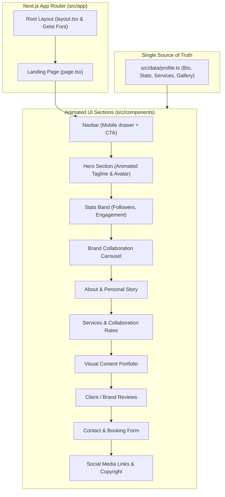

# Creator & Influencer Portfolio: Next.js 16, React 19 & Tailwind CSS v4

<div align="center">

[](https://github.com/codewithmuh/ai-web/releases)
[](https://opensource.org/licenses/MIT)
[](https://github.com/codewithmuh/ai-web/stargazers)
[](https://github.com/codewithmuh/ai-web/network/members)
[](https://nextjs.org/)
[](https://react.dev/)
[](https://tailwindcss.com/)
[](https://www.framer.com/motion/)
[](https://www.youtube.com/@codewithmuh)

**A high-converting, animated portfolio website template designed for digital creators, influencers, and creative agencies. Built on Next.js 16, React 19, Tailwind CSS v4, and Framer Motion.**

[Features](#key-features) • [Component Architecture](#component-architecture) • [Quick Start](#getting-started) • [Customization](#single-file-customization)

</div>

---

## Overview

**`ai-web`** provides an editorial, visual-first portfolio website template for content creators, photographers, travel influencers, and modern agencies. With single-file data configuration, buttery scroll animations via Framer Motion, and mobile-first responsive design using Tailwind CSS v4, this template allows anyone to launch a brand showcase in minutes.

---

## Key Features

- **Cutting-Edge Stack:** Powered by Next.js 16 (App Router), React 19, and Tailwind CSS v4.
- **Fluid Scroll Animations:** Scroll-triggered entrances and micro-interactions powered by Framer Motion 12.
- **Single Source of Truth:** Update your entire website—name, social metrics, brand sponsors, services, photos, and contact info—by editing one file: [`src/data/profile.ts`](src/data/profile.ts).
- **Responsive Media Gallery:** Showcase high-resolution visual work with responsive grid layouts.
- **Brand Partnership Band:** Highlight past sponsorships, client logos, and verified performance statistics.
- **SEO & Social Share Ready:** Fully optimized OpenGraph metadata, fast core web vitals, and clean semantic markup.

---

## Component Architecture



---

## Getting Started

### Prerequisites

- [Node.js](https://nodejs.org/) (v18 or higher)
- [npm](https://www.npmjs.com/) or [pnpm](https://pnpm.io/)

### Installation

1. **Clone the repository:**
   ```bash
   git clone https://github.com/codewithmuh/ai-web.git
   cd ai-web
   ```

2. **Install dependencies:**
   ```bash
   npm install
   ```

3. **Start local development server:**
   ```bash
   npm run dev
   ```

4. Open [http://localhost:3000](http://localhost:3000) to preview your site.

---

## Single-File Customization

Customize all site content in [`src/data/profile.ts`](src/data/profile.ts):

```typescript
export const profile = {
  name: "Your Name",
  handle: "@yourhandle",
  role: "Content Creator & Storyteller",
  location: "New York, USA",
  tagline: "Crafting narratives that move communities",
  bio: "Full-time creator collaborating with global lifestyle brands...",
  email: "contact@yourdomain.com",
  avatar: "/your-photo.jpg",
};

export const stats = [
  { label: "Followers", value: "250K", icon: "instagram" },
  { label: "Monthly Views", value: "3.2M", icon: "youtube" },
  { label: "Engagement Rate", value: "8.4%", icon: "trending" },
];
```

---

## Production Deployment

Deploy seamlessly to [Vercel](https://vercel.com/) with zero configuration:

```bash
npm run build
```

---

## License

This project is open-source under the [MIT License](LICENSE).
